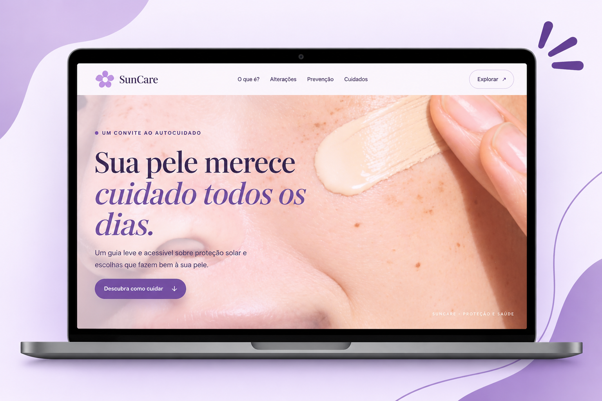
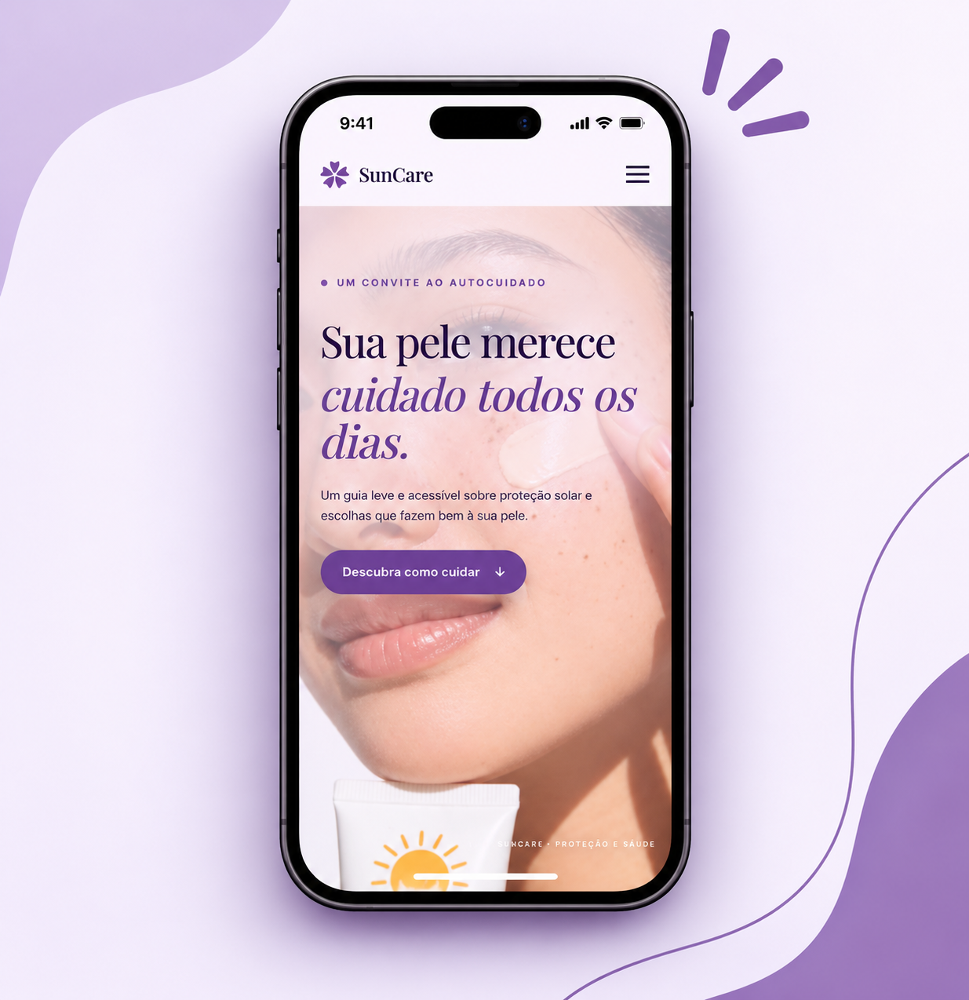

# SunCare — Projeto sobre Fotoenvelhecimento ☀️🧴

Landing page *mobile-first* desenvolvida como parte de um **projeto de extensão acadêmica** para o curso de Estética. O site foi criado para servir como um material de apoio interativo e acessível via **QR Code** em exposições e apresentações do projeto.

---

## Demonstração visual

Confira as versões desktop e mobile do SunCare:

<table>
  <tr>
    <td align="center" width="60%">
      <strong>Website</strong>
    </td>
    <td align="center" width="40%">
      <strong>Mobile</strong>
    </td>
  </tr>
  <tr>
    <td align="center" valign="middle">
      
    </td>
    <td align="center" valign="middle">
      
    </td>
  </tr>
</table>

## Sobre o Projeto
O objetivo principal é traduzir o conteúdo teórico e científico do trabalho acadêmico sobre fotoenvelhecimento, proteção solar e cuidados diários com a pele em uma experiência digital rápida, educativa e de fácil leitura em dispositivos móveis.

## Funcionalidades
- **Design *Mobile-First*:** Otimizado para leitura fluida em smartphones (ponto de acesso principal via QR Code).
- **Seletor de Tipos de Pele:** Ferramenta interativa para direcionar orientações específicas de cuidados.
- **Conteúdo Baseado em Evidências:** Resumo didático estruturado a partir da documentação acadêmica do projeto de extensão.

## Estrutura do Repositório
- `index.html` — Arquivo principal com a estrutura e o conteúdo educativo.
- `style.css` — Folha de estilos responsável pelo layout responsivo e design visual.
- `script.js` — Lógica de interatividade (manipulação do DOM para o menu e seletores).

## Acesse o projeto 
Explore o SunCare e conheça o guia interativo de fotoproteção.

  <a href="https://suncare-beta.vercel.app/" target="_blank">
    <strong>Acessar SunCare ↗</strong>
  </a>

